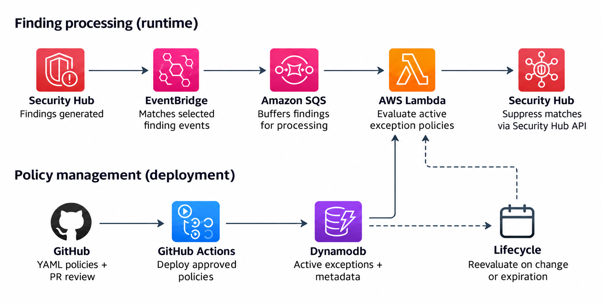

# AWS Security Hub Policy Engine

A policy-as-code solution for managing AWS Security Hub finding suppressions.

Define security exceptions as simple YAML policies, manage reviews and approvals via pull requests, and automatically suppress matching findings in AWS Security Hub.

Rather than maintaining individual Security Hub automation rules for every exception, this repository provides a centralized, scalable approach to managing security exceptions with clear ownership, expiration dates, and a Git-based audit trail.

## Problem Statement

Managing security exceptions across multiple AWS accounts can become challenging as Security Hub findings grow. Some risks are temporarily accepted, while others are mitigated through compensating controls.

Rather than maintaining individual automation rules and being constrained by Security Hub's 100-rule limit, this repository defines exceptions as reusable YAML policies.

Policies are managed through Git, require approval before taking effect, and include expiration dates and clear audit trails. Matching findings are automatically suppressed, providing a scalable and controlled approach to security exception management.

## How it works



Security exceptions are managed as YAML policies and reviewed through GitHub pull requests. Once approved and merged, GitHub Actions automatically deploys the policies to DynamoDB.

New findings from AWS Security Hub are routed through EventBridge and SQS to a Lambda function, where they are evaluated against active policies. If a finding matches an applicable policy, it is automatically suppressed.

Findings are automatically reevaluated whenever they are updated or the suppression expires. Previously suppressed findings are reopened only when no other active, approved policy applies.

## Example policy

This example suppresses one Security Hub control on a tagged development resource until the end of 2026:

```yaml
id: SEC-00421
name: Development exception
owner: cloud-security
ticket: SEC-421
reason: Risk accepted for resources in development

accounts:
  - "123456789012"
regions:
  - eu-central-1

match:
  control_id: EC2.13
  tags:
    Environment: Development

action: SUPPRESS
expires_at: "2026-12-31T23:59:59Z"
```

## Resource matching support

Policies can target **individual AWS resources or groups of resources** using these selectors:

| Match by | Example |
| --- | --- |
| **Resource ARN or ID** | `arn:aws:s3:::example-bucket` |
| **Resource tags** | `Environment: Development` |
| **AWS account** | `123456789012` |
| **AWS Region** | `eu-central-1` |
| **Resource type** | `AwsEc2Instance` |
| **Resource ID patterns** | `arn:aws:s3:::dev-*` |

## Tech Stack

- **Language & Runtime:** Python, AWS Lambda
- **Event Processing:** Amazon EventBridge, Amazon SQS
- **Data Storage:** Amazon DynamoDB
- **Security:** AWS Security Hub
- **Infrastructure:** Terraform
- **CI/CD:** GitHub Actions

For a walkthrough of the architecture, code, policies, and deployment, continue with the [documentation guide](doc/readme.md).