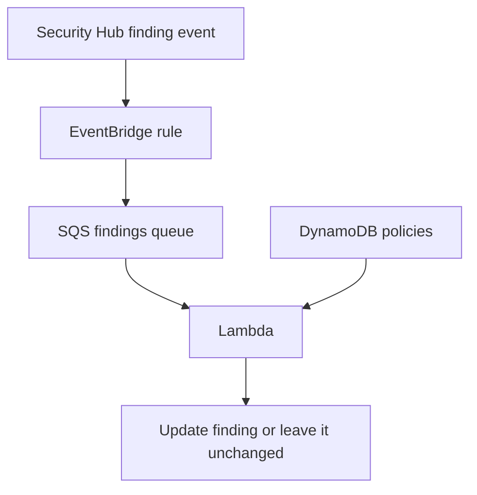

# How the AWS services fit together

[Back to the guide](../readme.md)

## A new or updated finding



The EventBridge rule accepts `Security Hub Findings - Imported` events from `aws.securityhub`. These include new findings and updates.

SQS holds the messages until Lambda processes them. Lambda's event source mapping polls the queue and supplies messages to the handler. The queue does not run the Python code itself.

Lambda fetches the latest finding, looks up relevant policies, and asks the matcher whether any policy applies. A finding can arrive before any policy exists; it is then left unchanged.

## The daily check

EventBridge Scheduler sends this input directly to Lambda:

```json
{"action": "reconcile"}
```

The schedule uses `rate(1 day)`. This is separate from the EventBridge rule that receives finding events.

The scan selects only findings with:

```text
RecordState = ACTIVE
Workflow.Status = SUPPRESSED
UserDefinedFields.ShpeManaged = true
```

It queues those findings in SQS. The same processing code then decides whether they should remain suppressed. It does not scan every finding every day, and it leaves suppressions without the engine ownership marker alone.

The schedule provides another opportunity to process expired exceptions even if no finding event arrives. Expiry does not itself send an event. Reopening occurs on a later successful event or scan, not necessarily at the exact expiry time.

## Publishing policy changes

The publishing script starts two separate scans after changing DynamoDB:

| Action | Findings selected | Purpose |
| --- | --- | --- |
| `reconcile` | Active, engine-managed suppressions | Reopen findings when an exception no longer applies, or update the winning policy. |
| `backfill` | Active findings with workflow status `NEW` | Apply new exceptions to findings already present. |

Backfill is not a daily scheduled task. Publishing unchanged policies does not trigger either scan.

## Batches and retries

The scanner requests up to 100 findings per page and sends them to SQS in batches of 10. Processing Lambda invocations receive up to 10 SQS messages and process them sequentially. A Security Hub message can contain multiple findings. Separate Lambda invocations may run concurrently.

Failed messages are reported through `batchItemFailures` so Lambda can retry them. The queue is configured with a maximum receive count of 5 before moving repeatedly failing messages to the dead-letter queue. Messages may be delivered more than once, so processing must tolerate repeats.

The findings queue retains messages for 4 days; the dead-letter queue retains them for 14 days. This dead-letter queue covers the SQS processing path, not failed Scheduler deliveries or direct asynchronous Lambda invocations.

## Files defining this infrastructure

- [eventbridge.tf](../../infrastructure/eventbridge.tf): finding routing and daily Scheduler configuration.
- [sqs.tf](../../infrastructure/sqs.tf): queues, retries, and EventBridge permissions.
- [lambda.tf](../../infrastructure/lambda.tf): Python package, function settings, and queue integration.
- [iam.tf](../../infrastructure/iam.tf): permissions for Lambda, Scheduler, and GitHub.

The deployment runs in the configured AWS Region. Listing multiple accounts or Regions in a policy does not deploy infrastructure there or grant access to their findings. The engine can only process findings visible to its configured Security Hub client.
